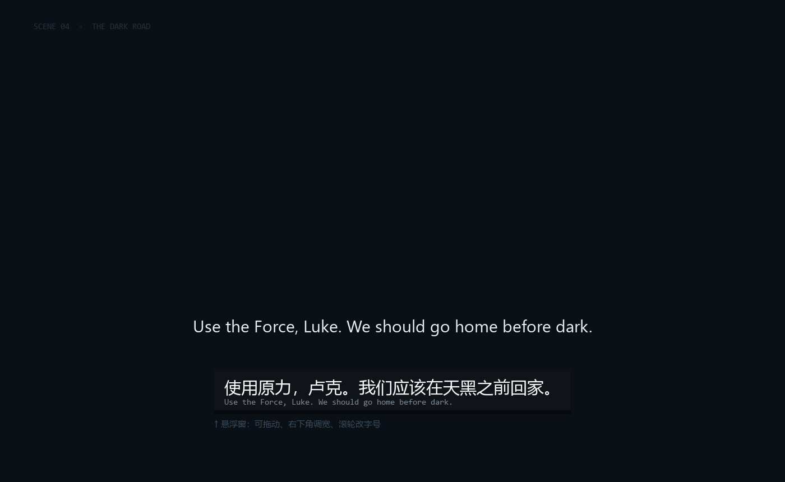

# 屏译 · 屏幕英文实时翻译

> 框住屏幕上一块英文区域 → 本地 OCR 认字 → 联网翻译 → 悬浮窗显示中文。
>
> 字幕、游戏对话、英文视频、生肉课程，都能一边看一边出中文。
>
> Windows 小工具，Python + tkinter 编写，本地 OCR（RapidOCR / ONNX Runtime）+ 免费在线翻译。



<sub>效果示意图：上方是屏幕上的英文原文，下方是悬浮窗里的中文译文。</sub>

---

## 特性

- **框选即用**：点「选区域」拖一个框，框住常出英文字的那一条（别框整屏，越小越快）。
- **本地 OCR**：识别用 RapidOCR + ONNX Runtime，全在本地跑，**截图不会上传**。
- **免注册翻译**：走必应 / MyMemory 免费网页接口，不需要 API key。
- **不重复翻译**：画面没变就跳过；句子只抖动一两个字也算同一句，不会反复刷屏。
- **悬浮窗可调**：随意拖动；拖右下角 `◢` 改宽度（双击恢复自动宽度）；滚轮改字号，全部自动保存。
- **网络断了会自己重试**：不再把已有译文擦掉。
- **纯 CPU 可跑**：一帧约 1～2 秒（区域小的话），不需要显卡。

## 环境要求

| 项目 | 要求 |
| --- | --- |
| 系统 | Windows 10 / 11（用到 `ImageGrab` 截屏和 `tkinter`） |
| Python | 3.10 ~ 3.14，**64 位** |
| 网络 | 只有翻译那一步联网（必应 / MyMemory） |

## 安装

```bat
git clone https://github.com/<你的用户名>/Real-time-screen-translation.git
cd Real-time-screen-translation
pip install -r requirements.txt
```

> `pip` 装不动（公司网络 / 无外网源）时，用仓库自带的解析脚本，它从阿里云镜像直接下 wheel 解压到 `vendor/`：
>
> ```bat
> python _resolve_deps.py
> ```
>
> 之后程序会优先从 `vendor/` 加载依赖。

## 使用

1. 双击 `启动.bat`（或 `python screen_translate.py`）。
2. 点 **选区域**，按住左键框住字幕所在的那一条（框选时会实时显示 `宽 × 高`）。
3. 点 **开始**，悬浮窗出现在屏幕下方居中。
4. 拖到合适位置；拖右下角 `◢` 调宽；滚轮调字号。
5. 停止：面板上点 **清除**，或直接关掉面板。

**出问题先点「测一下」**：它会拍一帧、认一次、翻一次，把每一步结果弹出来，一眼能看出卡在哪。

## 配置

首次运行会生成 `config.json`（参考 `config.example.json`）：

| 键 | 说明 | 默认 |
| --- | --- | --- |
| `region` | 识别区域 `[x1, y1, x2, y2]`，物理像素 | `null` |
| `interval` | 截图间隔（秒），越小越跟手但越费 CPU | `0.6` |
| `font_size` | 悬浮窗字号 | `22` |
| `width` | 悬浮窗宽度上限 | `900` |
| `fixed_width` | 拖过右下角后为 `true`，宽度固定 | `false` |
| `alpha` | 悬浮窗透明度 | `0.82` |
| `engine` | 翻译通道：`bing` / `mymemory` | `bing` |
| `show_source` | 悬浮窗是否附英文原文 | `true` |

## 工作原理

```
屏幕区域 ──截图──> 缩放/放大 ──> RapidOCR(本地) ──> 行合并
      ──> 相似度去重（最近 6 句，>85% 视为同一句）
      ──> 必应翻译（失败自动切 MyMemory）──> 结果缓存 ──> 悬浮窗
```

几个实现细节：

- **防自激**：截图时会把悬浮窗、控制面板所在的矩形涂黑，避免把自己的译文又 OCR 一遍造成无限循环。
- **DPI 感知**：启动时声明 per-monitor DPI aware，125%/150% 缩放下框选坐标仍然对得上。
- **整屏/全屏独占游戏** 系统截不到画面，请把游戏改成「无边框窗口」或「窗口模式」。

## 常见问题

| 现象 | 原因 / 处理 |
| --- | --- |
| 一直显示「框里没认出字」 | 区域没对准，或太小。字幕条一般要几百像素宽、30px 以上高 |
| 截到的是纯黑画面 | 游戏全屏独占，改窗口化 / 无边框窗口 |
| 「网络不通，自动重试中」 | 断网或翻译接口被拦，恢复后会自动继续；也可把 `engine` 换成 `mymemory` |
| 帧率很慢 | 区域框太大；只框字幕那一行。也把 `interval` 调大一点 |
| 识别出中文乱码 | 只支持英文原文；非英文区域会 OCR 出噪声 |
| 双屏坐标不对 | 目前按主屏物理像素计算，副屏上框选可能偏移 |

日志在同目录 `log.txt`：每帧的识别用时、识别到的原文、译文都在里面。

## 目录结构

```
screen_translate.py   主程序（OCR 循环 / 翻译 / 悬浮窗 / 框选）
_resolve_deps.py      无 pip 时的依赖安装器（阿里云镜像 → vendor/）
_selftest.py          自检：OCR + 翻译链路
启动.bat              Windows 双击启动
requirements.txt      Python 依赖
docs/screenshot.png   README 效果图
config.example.json   配置示例
```

## 已知限制

- 只做**英 → 中**。
- 每帧约 1～2 秒（纯 CPU），做不到真正的实时逐字；字幕一般停留 2～3 秒，够用。
- 翻译走公开网页接口，可能随时失效；失效时改 `engine` 或提 issue。

## 免责声明

- 本项目仅用于**个人学习与无障碍阅读**。截图只在本地处理，仅识别出的**文字**会发给翻译接口。
- 使用场景请自行遵守所看内容（游戏 / 影视 / 课程）的服务条款与版权规定。
- 翻译结果由第三方接口提供，不保证准确。

## 许可

代码以 [MIT](LICENSE) 协议开源。

第三方依赖协议：RapidOCR（Apache-2.0）、ONNX Runtime（MIT）、OpenCV（Apache-2.0）、Pillow（HPND）、NumPy（BSD-3-Clause）。
